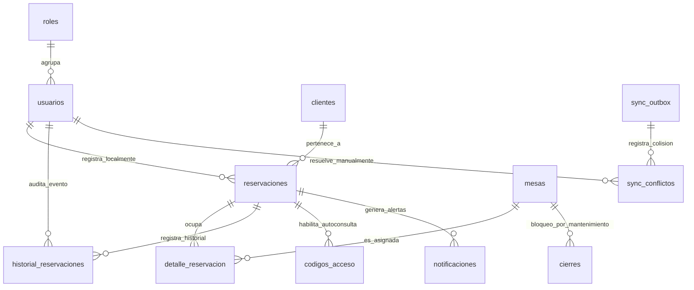

# Modelo Entidad-Relación y Diccionario de Datos — ReserveSync

Este documento contiene la arquitectura de datos definitiva para **ReserveSync**, compatible con **SQLite** (aplicación de escritorio offline) y **PostgreSQL** (backend central Spring Boot).

## 1. Diagrama Entidad-Relación (Mermaid)

## 2. Resumen de Tablas

1. **`roles`**: Perfiles de usuario (`ADMIN`, `RECEPCIONISTA`, `MESERO`).
2. **`usuarios`**: Cuentas del personal con credenciales BCrypt y control de borrado lógico.
3. **`clientes`**: Datos de comensales identificados por teléfono y correo electrónico.
4. **`mesas`**: Ubicación en sala/terraza/bar, capacidades mínima y máxima, y estado operativo.
5. **`reservaciones`**: Fechas, horas (`fecha_hora_inicio` y `fecha_hora_fin` UTC), canal de origen, comensales y estados (`estado_reserva` y `estado_sync`).
6. **`detalle_reservacion`**: Relación muchos a muchos para asignar una o más mesas contiguas a una reserva.
7. **`horarios`**: Franjas y turnos de atención por día de la semana (1=Lunes a 7=Domingo).
8. **`cierres`**: Bloqueos globales por festivos o bloqueos parciales por zonas/mesas en mantenimiento.
9. **`configuracion`**: Claves y valores del sistema (anticipación, tolerancias, duración de sobremesa).
10. **`historial_reservaciones`**: Auditoría inmutable de cambios de estado y acciones sobre reservas.
11. **`codigos_acceso`**: Tokens seguros para autoconsulta y cancelación web sin credenciales.
12. **`notificaciones`**: Registro y cola de recordatorios o correos de confirmación.
13. **`sync_outbox`**: Cola local de mutaciones offline con `operation_id` para idempotencia.
14. **`sync_cursor`**: Puntero temporal del último lote sincronizado por cada terminal.
15. **`sync_conflictos`**: Registro detallado de colisiones para resolución asistida en la interfaz.

## 3. Scripts Implementados

- `database/sqlite/schema.sql`: DDL optimizado para SQLite (tipos TEXT/INTEGER, `PRAGMA foreign_keys = ON`, índices parciales).
- `database/postgresql/schema.sql`: DDL optimizado para PostgreSQL (tipos UUID, TIMESTAMPTZ, BOOLEAN, JSONB).
- `database/seed/sqlite_seed.sql`: Semilla con catálogo, mesas, horarios, usuarios y 4 reservas de prueba realistas.
- `database/seed/postgresql_seed.sql`: Semilla equivalente con sintaxis e integridad para PostgreSQL.
