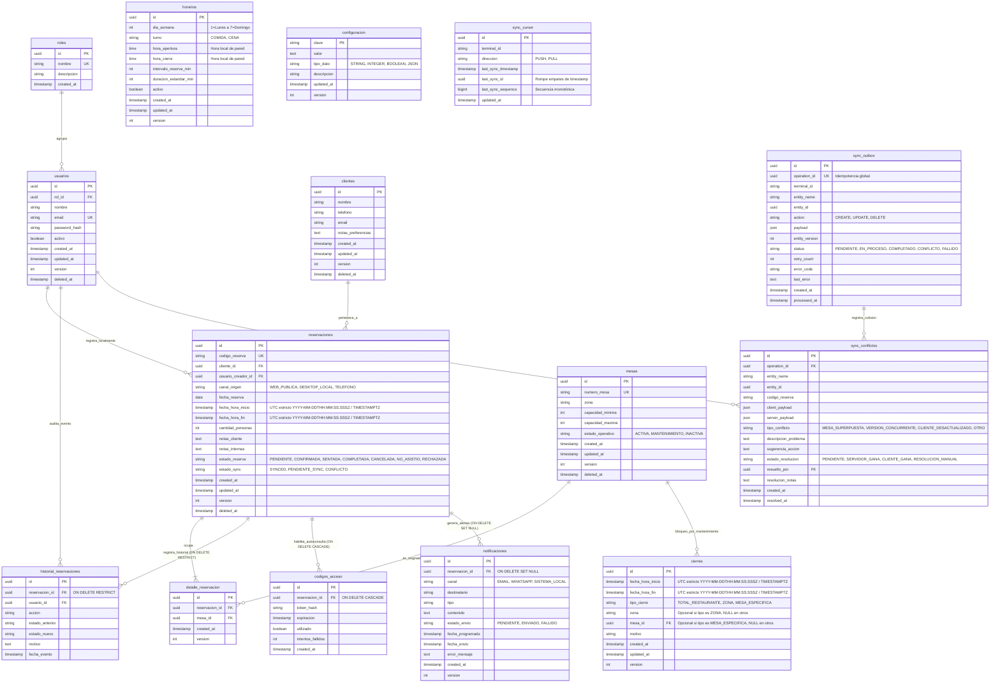

# Modelo Entidad-Relación y Diccionario de Datos — ReserveSync

Este documento contiene la arquitectura de datos definitiva para **ReserveSync**, compatible con **SQLite** (aplicación de escritorio offline) y **PostgreSQL** (backend central Spring Boot), tras la auditoría final y corrección de integridad transaccional, concurrencia, normalización de marcas de tiempo y sincronización.

---

## 1. Diagrama Entidad-Relación (Mermaid)

---

## 2. Diccionario de Datos y Reglas de Integridad

### 2.1 Normalización Estricta de Timestamps UTC
- **En SQLite (TEXT):**
  Las marcas temporales de `reservaciones` (`fecha_hora_inicio`, `fecha_hora_fin`) y `cierres` (`fecha_hora_inicio`, `fecha_hora_fin`) exigen por restricción `CHECK`:
  1. Longitud exacta de 24 caracteres: `length(ts) = 24`.
  2. Patrón estricto ISO-8601 con milisegundos y terminación literal en `Z`:
     `GLOB '[0-9][0-9][0-9][0-9]-[0-9][0-9]-[0-9][0-9]T[0-9][0-9]:[0-9][0-9]:[0-9][0-9].[0-9][0-9][0-9]Z'`.
  3. Validación de fecha y hora real: `datetime(ts) IS NOT NULL AND strftime('%Y-%m-%dT%H:%M:%S', ts) = substr(ts, 1, 19)`.
  4. Se rechazan offsets horarios (ej. `-06:00`), fechas inválidas (ej. 31 de febrero) y precisiones variables. Esto garantiza orden lexicográfico equivalente al orden cronológico absoluto.
- **En PostgreSQL (TIMESTAMPTZ):**
  Se preserva el tipo nativo `TIMESTAMPTZ` con precisión de microsegundos, serializando en UTC.

### 2.2 Restricciones de Alcance de Cierres
- `TOTAL_RESTAURANTE`: exige `zona IS NULL AND mesa_id IS NULL`.
- `ZONA`: exige `zona NOT NULL AND mesa_id IS NULL`.
- `MESA_ESPECIFICA`: exige `mesa_id NOT NULL AND zona IS NULL`.
- Intervalo positivo obligatorio: `CHECK (fecha_hora_fin > fecha_hora_inicio)`.

### 2.3 Estados que Ocupan Mesas y Reglas de Reactivación
- **Estados Activos que Bloquean Mesas:** `PENDIENTE`, `CONFIRMADA` y `SENTADA`.
- **Estados Inactivos que Liberan Mesas:** `COMPLETADA`, `CANCELADA`, `NO_ASISTIO` y `RECHAZADA`.
- **Reactivación de Reservaciones:** Cuando una reservación cancelada o eliminada lógicamente pasa a estado activo, el trigger `trg_validar_reserva_update` / `fn_validar_reserva_update` valida **todas las mesas asignadas** a dicha reservación:
  - Si alguna mesa fue desactivada (`estado_operativo != 'ACTIVA'`), eliminada lógicamente (`deleted_at IS NOT NULL`) o ya no existe, la reactivación es rechazada.
  - Se revalidan solapamientos con otras reservas activas y colisiones con cierres.

### 2.4 Bitácora de Auditoría Inmutable
- `historial_reservaciones.reservacion_id` aplica **`ON DELETE RESTRICT`**.
- La bitácora histórica nunca puede ser eliminada en cascada por un borrado físico accidental de la reservación padre.

### 2.5 Propuesta de Secuencia Monotónica y Sincronización
- `sync_cursor` mantiene punteros independientes para `PUSH` (subida terminal -> servidor) y `PULL` (descarga servidor -> terminal).
- La columna `last_sync_sequence` se asociará en el backend a un generador global de secuencias (`global_sync_seq`) en PostgreSQL vinculado a una bitácora inmutable de eventos (`sync_changelog`).
- La columna `last_sync_id` rompe empates cuando dos mutaciones comparten exactamente la misma marca de tiempo.
